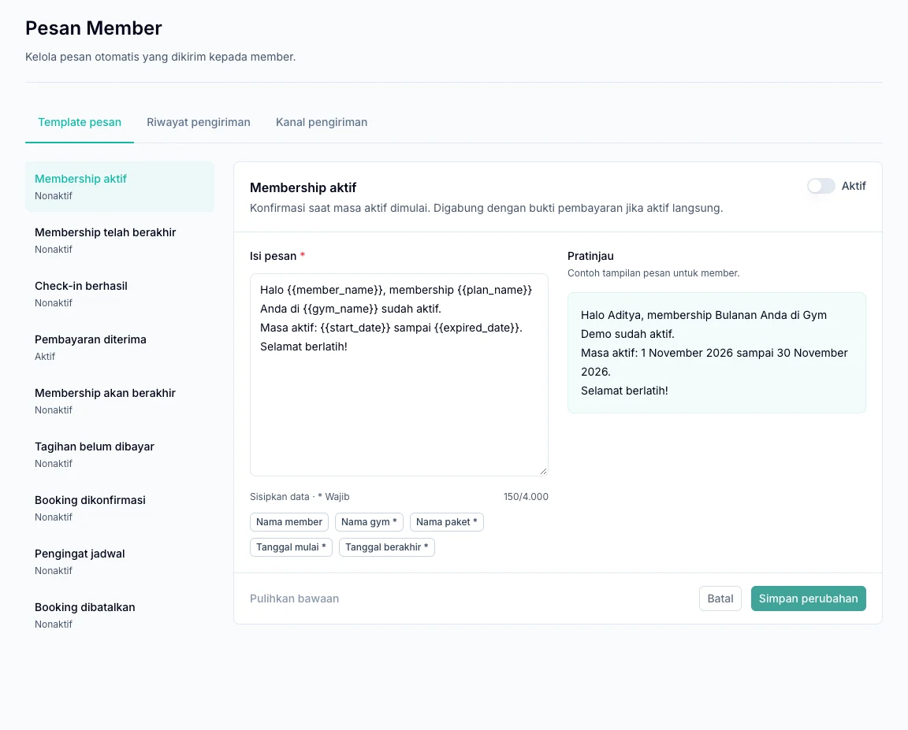

Send payment receipts, membership information, and schedule reminders through WhatsApp. Manage everything in **Pengaturan → Pesan Member** using the gym owner's account.

| Section | Use it to |
| --- | --- |
| Template pesan | Edit message content and enable message types. |
| Riwayat pengiriman | Check recipients and delivery results. |
| Kanal pengiriman | Connect the gym's WhatsApp number. |

## 1. Connect the gym's WhatsApp number

1. Open the **Kanal pengiriman** tab.
2. Follow the displayed number-linking steps.
3. Complete linking from the WhatsApp device you want to use.
4. Wait for the connection to be ready.
5. Send a test message if needed and check **Riwayat pengiriman**.

## 2. Customize and enable templates

1. Open **Template pesan** and choose a message type.
2. Adjust the wording to match your gym's communication style.
3. Keep required variables: placeholders automatically filled with details such as a member's name or schedule.
4. Review the preview, enable the template, and save.

<Note>
  Previews use sample data. Check **Riwayat pengiriman** for messages actually processed. Content changes, including restoring the default template, take effect only after saving.
</Note>

*Select a message type on the left, then check the content and preview before saving. The preview uses sample data.*

## Choose the messages your gym needs

| Message type | When it is used |
| --- | --- |
| Payment receipt | After a member's payment succeeds. |
| Successful check-in | After a member's arrival is recorded. |
| Membership active | When the active period begins under the purchase terms. |
| Membership expiring | A reminder before the active period ends. |
| Membership expired | Notification that the period has ended. |
| Unpaid invoice | A reminder for an eligible unpaid membership invoice. |
| Booking confirmed | Confirmation of a class or PT booking. |
| Schedule reminder | A reminder before the scheduled session begins. |
| Booking cancelled | Notification of an eligible booking cancellation. |

Expiring membership reminders are scheduled from 09:00, three days before the last active day, using the membership's time zone. Memberships renewed without a gap may not receive this reminder.

## 3. Check member consent

Check the phone number and **Member setuju menerima notifikasi WhatsApp** on the member profile. An enabled template alone is not enough: the connection must be ready and the member must consent to notifications.

Payment receipts follow profile consent; there is no additional checkbox to enable for every point-of-sale transaction.

## 4. Monitor delivery

Open **Riwayat pengiriman** and check the recipient and message status. A queued message has not necessarily been delivered or read.

If a message is not sent, check the connection, template status, member number and consent, and the source transaction or schedule status. Template changes apply to new messages and do not rewrite messages already queued.

Messages are sent gradually according to platform delays and limits. Enabling a template does not automatically resend all historical events.

Topbar notifications are for application users. This page configures outgoing messages to members.
