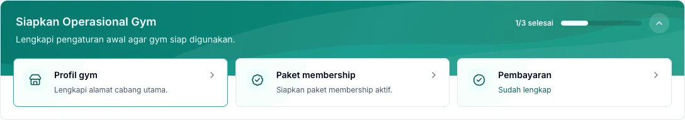

Set up your gym once, then invite your team to start working. Follow these steps with the gym owner's account so the essential settings are ready before your first transaction.

*Use the checklist on the Dashboard to open any setup steps that are still incomplete.*

## 1. Check your gym subscription

Sign in as the gym owner and open **Langganan**. If access is awaiting activation, complete the steps shown before using operational features.

<Note>
  A Kavosto subscription gives your gym access to the application. A membership gives a member access to the gym. [Learn the difference](/en/administration/kavosto-subscription).
</Note>

## 2. Complete your profile and branches

Open **Pengaturan → Profil Gym** to check your gym's identity and time zone. Then review the information in **Cabang**.

Make sure the active branch in the navigation matches where you are working. The data shown also depends on your account's branch access.

## 3. Set up plans and payments

1. Create plans in **Paket & Layanan → Paket Membership**.
2. Set the price, duration, and branch access.
3. Configure accepted payment methods in **Pengaturan → Metode Pembayaran**.
4. Review tax and receipt settings for your gym.
5. Choose whether the point of sale requires shifts in **Pengaturan → Kasir**.

See [Memberships](/en/operations/memberships) and [Cashier shifts](/en/operations/cashier-shifts).

## 4. Set up your team

Add accounts through **Staff**, then assign roles and branch access based on each person's responsibilities. Give each team member their own account so transactions can be traced to the correct person.

## 5. Prepare products and opening stock

If your gym sells goods, create units, products, suppliers, and warehouses. Save the valuation method in **Pengaturan → Persediaan** before recording your first stock movement.

<Warning>
  The owner must choose and save **FIFO** or **Average**, even if keeping the default FIFO selection. The method applies to the whole gym and locks after the first stock movement. [Read the setup steps and method comparison](/en/products-inventory/inventory#set-up-warehouses-and-valuation).
</Warning>

- Record goods already on hand before Kavosto through an incoming stock adjustment.
- Record supplier purchases through purchase orders and goods receipts.

See [Products and units](/en/products-inventory/products-and-units) and [Inventory](/en/products-inventory/inventory).

## 6. Check your first service flow

Register a member, record a membership purchase, complete its payment, and check the membership period. Then record the member's arrival through **Check-in**.

For automated WhatsApp messages, connect the gym's number and review templates and member consent in [Member messages](/en/administration/member-messages).

## Before your first transaction

Check the selected branch, plans available for sale, payment methods, and each staff member's ability to sign in with their own account. If selling stock-managed goods, also check the sales warehouse balance.
