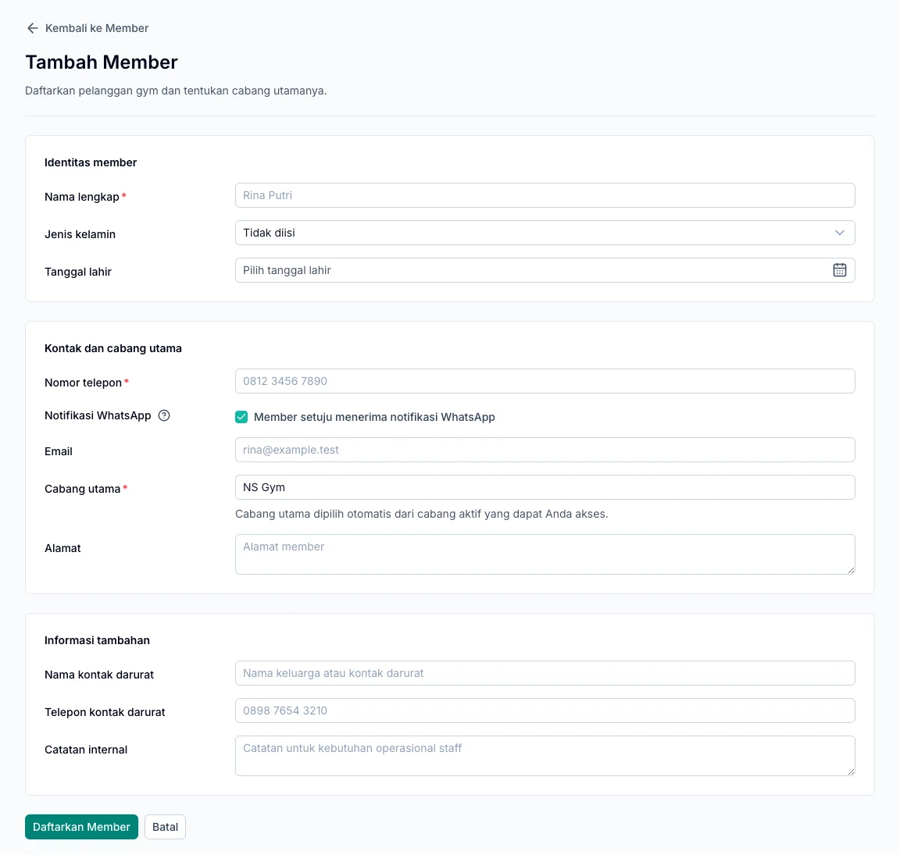

Manage customer identities, contact details, and service history through **Member**. Start with an accurate profile so purchases and visits are linked to the right person.

<Note>
  Creating a member profile does not automatically grant gym access. The member still needs a paid membership that is valid for the visit.
</Note>

## Add a member

1. Open **Member** and add a new member.
2. Enter their full name and contact details.
3. Select the correct primary branch.
4. Complete any additional information needed, such as an emergency contact.
5. Review **Member setuju menerima notifikasi WhatsApp** (consent to WhatsApp notifications).
6. Save, then check the name, contact details, and branch on the member's profile.

WhatsApp consent is selected by default on a new form. Adjust it to match the member's actual consent and check the destination number before saving.

*Member registration form. Gray name and contact text is a placeholder, not an existing member's data.*

## Update a member profile

Find the member in the list, open their profile, and choose edit. Check their name, phone number, and branch again before saving.

When changing a WhatsApp number, review notification consent as well. Turning off consent stops automated messages that have not yet been sent.

## Review memberships and history

Check the member's plan and membership period from their profile. Use transaction and service history to trace purchases linked to that member.

An unpaid membership, or one whose start date has not arrived, cannot be used for check-in. See the [membership guide](/en/operations/memberships).

## View and use add-ons

The **Add-on** tab shows paid purchases linked to the member. For services that support usage records, choose **Catat pemakaian** and review **Riwayat pemakaian**.

Gym check-in does not automatically deduct a general add-on balance. Class and personal training session balances are managed in their respective service modules.

## Cannot find a member?

Check the spelling, search terms, and active branch. If the profile is still missing, ask the owner to check your branch access before creating a duplicate.

Once the profile is ready, continue to [purchasing a membership](/en/operations/memberships).
