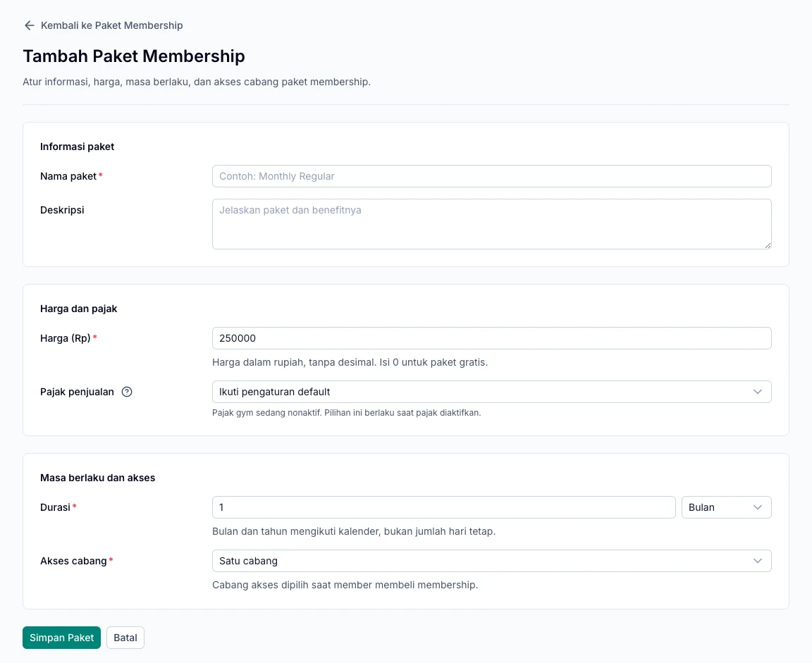

Use memberships to determine how long members can access the gym and which branches they can visit. Set up plans through **Paket & Layanan → Paket Membership**, then record each purchase for the member.

## Set up a membership plan

1. Add a membership plan.
2. Enter its name, price, and duration.
3. Choose days, weeks, months, or years for the duration.
4. Set access to one branch, selected branches, or all branches.
5. Review the applicable branches and save.

<Note>
  Month and year durations follow the calendar. A one-month plan is not always 30 days. Check the start and end dates in the purchase summary.
</Note>

Changing a catalog plan does not rewrite the terms of membership purchases that have already been recorded.

*Set the price, validity period, and branch access before selling the plan. Values in the screenshot are examples.*

## Sell a membership through the point of sale

1. Open **Kasir** at the correct transaction branch.
2. Select a membership plan from the catalog.
3. Select an active member, start date, and access branch if requested.
4. Review the cart and payment summary.
5. Receive payment using the selected method, then confirm.
6. Check the transaction result and the member's membership period.

A single point-of-sale transaction supports one membership plan. Use a separate transaction for another membership plan.

## Purchase from a member's profile

The member profile also provides **Beli Membership**. Choose a plan, branch, and start date, then use **Tinjau Pembelian** to review the summary before continuing.

If this creates an unpaid invoice, complete payment through the point of sale. Creating an invoice alone does not grant check-in access.

## Renew a membership

Create the next purchase for the same member. Check the old membership's end date and the new plan's start date to keep the periods appropriate and avoid overlap.

Payment for a future period does not necessarily give the member access today. Access follows the recorded validity period.

## Purchased but not available for use?

| Check | Required condition |
| --- | --- |
| Payment | Fully paid. |
| Validity period | The start date has arrived and the period has not ended. |
| Visiting branch | Included in the membership's access. |
| Status | The member and branch are active. |

Once everything is correct, record the arrival through [Check-in](/en/operations/check-in).
