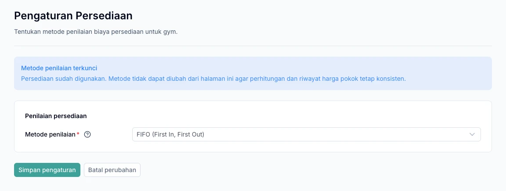

Monitor quantities in each warehouse through **Persediaan → Stok Barang**. Use the appropriate process when goods arrive, move, or need correction so stock history remains traceable.

## Set up warehouses and valuation

Create a warehouse under the correct branch through **Persediaan → Gudang**. The owner then saves the method in **Pengaturan → Persediaan** before the first stock movement.

This is an initial setting for the whole gym, not a choice repeated for each product, warehouse, or purchase.

1. Sign in with the owner's account.
2. Open **Pengaturan → Persediaan**.
3. Select **FIFO** or **Average** to match how the gym calculates inventory costs.
4. Choose **Simpan pengaturan**, even if keeping the initial FIFO selection.
5. Once saved, continue with opening stock or goods receipts.

| Method | Cost of outgoing goods |
| --- | --- |
| FIFO | Uses the cost of stock received first. |
| Average | Uses the weighted average stock value. |

For example, the gym receives 10 items costing Rp1,000 each, then 10 costing Rp2,000 each. For the first item issued, FIFO uses Rp1,000 and Average uses Rp1,500. This method determines inventory cost, not the selling price.

<Warning>
  You can change the method before the first stock movement. Once the first movement is successfully recorded, the method is locked and cannot be changed in settings. Saving a purchase draft alone does not lock it. FIFO calculates costs; it does not track physical product expiry.
</Warning>

*Example after inventory has been used: the valuation method is locked and cannot be changed.*

## Choose the right process

| Need | Use |
| --- | --- |
| Goods arriving from a supplier | Purchase orders and goods receipts |
| Opening stock or certain corrections | Penyesuaian Stok |
| Moving goods between warehouses | Transfer Stok |
| Matching records to physical quantities | Stok Opname |

## Opening stock and adjustments

1. Open **Persediaan → Penyesuaian Stok**.
2. Select the warehouse, incoming or outgoing direction, products, and quantities.
3. For incoming stock, enter the appropriate cost.
4. Add a reason or correction reference.
5. Save a draft, review it, then post it.

Posting applies the draft changes to stock. Posted documents cannot be edited; create a correction document if there is an error. Outgoing quantities cannot exceed available stock.

## Transfer between warehouses

1. Create a draft with different source and destination warehouses.
2. Add goods and quantities to move.
3. Choose **Kirim barang** after checking the document.
4. Staff at the destination choose **Terima barang** for the quantities actually delivered.

Dispatch reduces source stock. Destination stock increases only when a receipt is recorded. Partial receipts are allowed; the remaining goods stay in transit. Only drafts can be cancelled.

## Stock counts

1. Create a draft for the warehouse and products to count.
2. Count the physical goods after the baseline has been saved.
3. Enter the count: blank means not counted, while **0** means no goods are present.
4. Review differences and enter base-unit cost for any surplus.
5. Confirm once all goods have been counted.

### If stock changes during counting

Warehouse transactions can continue during a count. If **Stok berubah** appears, choose **Perbarui acuan**, then recount the changed products. Count during quieter periods to reduce repeated baseline updates.

## Trace stock differences

Check the warehouse and period, then reconcile receipts, transfers, sales, and adjustments. Trace the source documents before making corrections.

For supplier deliveries, continue to [Purchase orders](/en/purchasing/purchase-orders).
