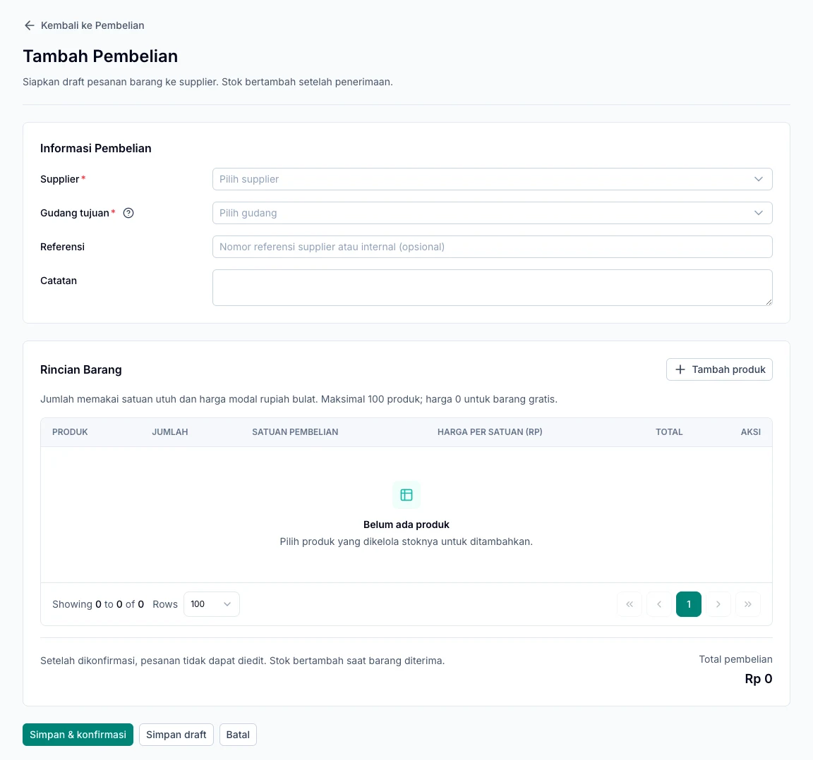

Record goods ordered from suppliers, then receive the quantities that actually arrive. Start in **Pembelian → Pembelian Barang**.

<Note>
  Stock increases when a goods receipt is recorded. Creating an order or paying a supplier does not add stock.
</Note>

## Before creating a purchase

Prepare an active supplier, a destination warehouse, and products with **Kelola stok** enabled. Before the first goods receipt, the owner must save the inventory valuation method.

## 1. Create an order

1. Open **Pembelian → Pembelian Barang** and add a purchase.
2. Select the supplier and destination warehouse.
3. Choose **Tambah produk** to open the product list.
4. Search by name or SKU, select one or more products, and add them.
5. Enter quantities, purchase units, and cost per selected unit.
6. Check the subtotal, reference, and notes.
7. Choose **Simpan draft** if the order still needs review, or **Simpan & konfirmasi** if it is ready.

Product selections are retained when you change pages or search for other products in the dialog. Products already in the order do not need to be added again. One purchase can contain up to 100 different products.

A PO number is generated automatically, such as `PO-202611-0001`. Keep it as a reference when receiving goods or recording a supplier invoice.

Once confirmed, order details cannot be edited. Confirmation is available only to accounts with the required permission.

*Choose the supplier and warehouse, then use Tambah produk to fill in the order items.*

## Understand order statuses

| Status | Meaning |
| --- | --- |
| Draft | Still being prepared and editable; no stock has been added. |
| Dikonfirmasi | Ready to receive; order details cannot be changed. |
| Diterima sebagian | Some goods have been received. |
| Diterima penuh | The full ordered quantity has been received. |
| Dibatalkan | The order has been stopped under the cancellation rules. |

## 2. Receive delivered goods

1. Open a confirmed order.
2. Choose **Terima barang**.
3. Enter the quantities actually delivered; enter zero for goods not yet received.
4. Check the units and remaining order quantities.
5. Confirm the receipt, then check stock in the destination warehouse.

### Example of partial receipt

You order **10 cartons**, but only **6 cartons** arrive. Record six first; the order becomes **Diterima sebagian**. When the remaining four arrive, open the same order and record another receipt.

## Cancel an order

An order with no receipts can be cancelled with a reason. If it has an active invoice, complete the applicable invoice cancellation first. Once any receipt exists, this action cannot cancel the order.

## 3. Record the invoice and payment

From purchase or receipt details, choose **Buat tagihan supplier** when available. Follow [Supplier invoices](/en/purchasing/supplier-invoices) to record the amount owed and its payments.

<AccordionGroup>
  <Accordion title="Saved but not confirmed?">
  Open the order details and check its status. If it is still a draft, correct the highlighted fields and confirm that document. There is no need to create another order for the same purchase.
  </Accordion>
</AccordionGroup>
