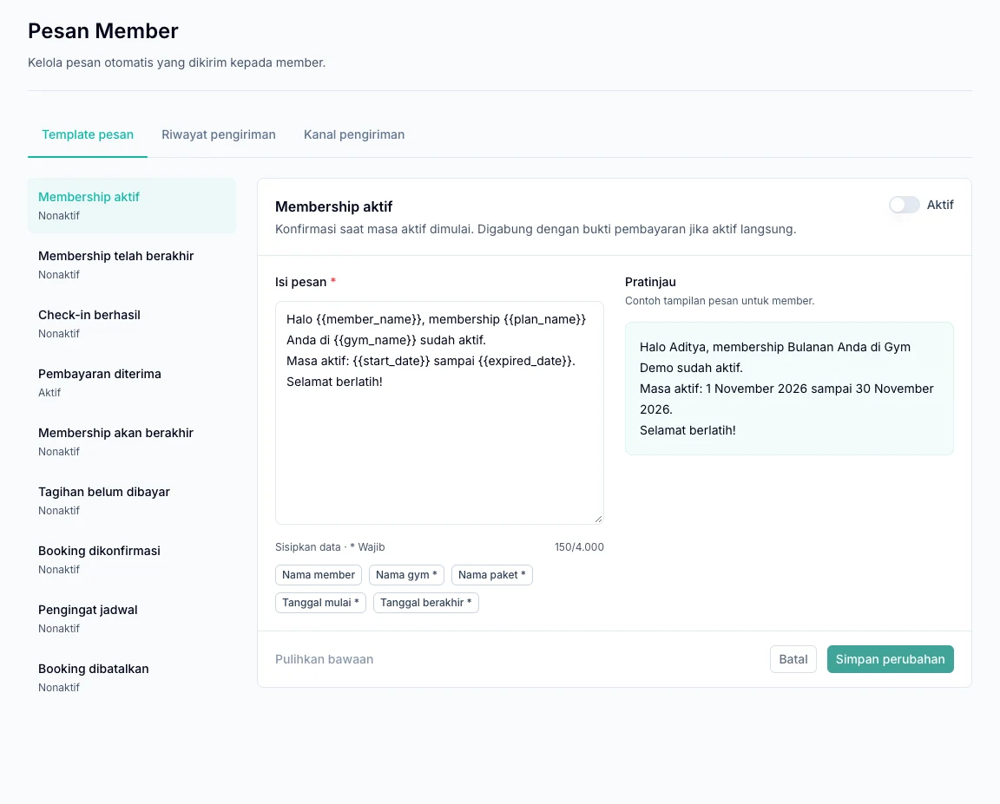

Kirim bukti pembayaran, informasi membership, dan pengingat jadwal melalui WhatsApp. Kelola semuanya dari **Pengaturan → Pesan Member** menggunakan akun pemilik gym.

| Bagian | Gunakan untuk |
| --- | --- |
| Template pesan | Mengatur isi dan jenis pesan yang aktif. |
| Riwayat pengiriman | Memeriksa penerima dan hasil pengiriman. |
| Kanal pengiriman | Menghubungkan nomor WhatsApp gym. |

## 1. Hubungkan WhatsApp gym

1. Buka tab **Kanal pengiriman**.
2. Ikuti langkah penautan nomor WhatsApp yang ditampilkan.
3. Selesaikan penautan dari perangkat WhatsApp yang akan digunakan.
4. Tunggu sampai status koneksi siap.
5. Gunakan pesan uji jika diperlukan, lalu periksa hasilnya di **Riwayat pengiriman**.

## 2. Sesuaikan dan aktifkan template

1. Buka **Template pesan** dan pilih jenis pesan.
2. Sesuaikan kalimat dengan gaya komunikasi gym.
3. Pertahankan variabel wajib, yaitu penanda yang akan diisi otomatis dengan data seperti nama member atau jadwal.
4. Periksa pratinjau, aktifkan template, lalu simpan.

<Note>
  Pratinjau menampilkan data contoh. Gunakan **Riwayat pengiriman** untuk memeriksa pesan yang benar-benar diproses. Perubahan isi, termasuk mengembalikan template ke bawaan, baru berlaku setelah disimpan.
</Note>

*Pilih jenis pesan di kiri, lalu periksa isi dan pratinjau sebelum menyimpan. Pratinjau memakai data contoh.*

## Pilih pesan yang dibutuhkan gym

| Jenis pesan | Kapan digunakan |
| --- | --- |
| Bukti pembayaran | Setelah pembayaran member berhasil. |
| Check-in berhasil | Setelah kedatangan member tercatat. |
| Membership aktif | Saat masa aktif dimulai sesuai ketentuan pembelian. |
| Membership akan berakhir | Pengingat menjelang akhir masa aktif. |
| Membership telah berakhir | Pemberitahuan berakhirnya periode. |
| Tagihan belum dibayar | Pengingat tagihan membership yang masih memenuhi syarat. |
| Booking dikonfirmasi | Konfirmasi jadwal kelas atau PT. |
| Pengingat jadwal | Pengingat sebelum jadwal dimulai. |
| Booking dibatalkan | Pemberitahuan pembatalan booking yang memenuhi syarat. |

Pengingat membership akan berakhir dijadwalkan mulai pukul 09.00 pada H-3 dari hari terakhir aktif, mengikuti zona waktu membership. Membership yang sudah diperpanjang tanpa jeda dapat tidak menerima pengingat tersebut.

## 3. Periksa persetujuan member

Periksa nomor telepon dan pilihan **Member setuju menerima notifikasi WhatsApp** pada profil member. Template aktif saja belum cukup: koneksi harus siap dan member harus menyetujui notifikasi.

Bukti pembayaran mengikuti persetujuan pada profil; tidak perlu mengaktifkan checkbox tambahan untuk setiap transaksi kasir.

## 4. Pantau hasil pengiriman

Buka **Riwayat pengiriman** dan periksa penerima serta status pesan. Pesan masuk antrean belum berarti sudah diterima atau dibaca.

Jika pesan tidak terkirim, periksa koneksi, status template, nomor dan persetujuan member, serta status transaksi atau jadwal sumbernya. Perubahan template berlaku untuk pesan baru, bukan menulis ulang isi pesan yang sudah mengantre.

Pengiriman berlangsung bertahap mengikuti jeda dan batas platform. Mengaktifkan template tidak otomatis mengirim ulang seluruh kejadian lama.

Notifikasi di topbar ditujukan kepada pengguna aplikasi. Pengaturan pada halaman ini khusus untuk pesan keluar kepada member.
