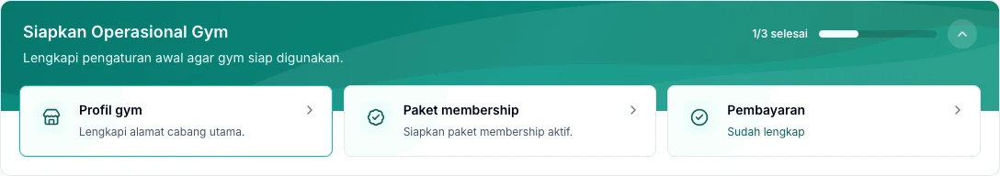

Siapkan gym satu kali, lalu ajak tim mulai bekerja. Ikuti urutan berikut menggunakan akun pemilik gym agar pengaturan utama tersedia sebelum transaksi pertama.

*Gunakan checklist di Dashboard untuk membuka pengaturan awal yang belum lengkap.*

## 1. Periksa langganan gym

Masuk menggunakan akun pemilik gym, lalu buka **Langganan**. Jika akses masih menunggu aktivasi, selesaikan langkah yang ditampilkan sebelum menggunakan fitur operasional.

<Note>
  Langganan Kavosto memberikan akses aplikasi untuk gym. Membership memberikan hak keanggotaan kepada member. [Pelajari perbedaannya](/id/administration/kavosto-subscription).
</Note>

## 2. Lengkapi profil dan cabang

Buka **Pengaturan → Profil Gym** untuk memeriksa identitas gym dan zona waktu. Kemudian periksa data pada menu **Cabang**.

Pastikan pilihan cabang aktif di navigasi sesuai tempat Anda bekerja. Data yang muncul juga mengikuti akses cabang akun tersebut.

## 3. Siapkan paket dan pembayaran

1. Buat paket pada **Paket & Layanan → Paket Membership**.
2. Tentukan harga, durasi, dan akses cabangnya.
3. Atur metode yang diterima pada **Pengaturan → Metode Pembayaran**.
4. Periksa pengaturan pajak dan struk sesuai operasional gym.
5. Tentukan apakah kasir bekerja dengan atau tanpa shift pada **Pengaturan → Kasir**.

Lihat [Membership](/id/operations/memberships) dan [Shift kasir](/id/operations/cashier-shifts).

## 4. Siapkan tim

Tambahkan akun melalui **Staff**, lalu berikan peran dan akses cabang sesuai tugas masing-masing. Gunakan akun sendiri untuk setiap petugas agar pencatatan transaksi dapat ditelusuri.

## 5. Siapkan barang jika gym menjual produk

Buat satuan, produk, supplier, dan gudang. Sebelum mencatat stok pertama, simpan metode penilaian pada **Pengaturan → Persediaan**.

<Warning>
  Pemilik gym perlu memilih dan menyimpan **FIFO** atau **Average** sebagai pengaturan awal, termasuk jika tetap memakai pilihan awal FIFO. Metode berlaku untuk seluruh gym dan terkunci setelah pergerakan stok pertama. [Lihat langkah dan perbedaan metodenya](/id/products-inventory/inventory#siapkan-gudang-dan-metode-penilaian).
</Warning>

- Barang yang sudah ada sebelum memakai Kavosto dicatat melalui penyesuaian stok masuk.
- Barang yang dibeli dari supplier dicatat melalui pembelian dan penerimaan barang.

Baca [Produk](/id/products-inventory/products-and-units) dan [Persediaan](/id/products-inventory/inventory).

## 6. Mulai melayani member

Daftarkan member, lakukan pembelian membership, lalu pastikan pembayaran dan periode aktifnya sesuai sebelum mencatat check-in.

Untuk mengirim bukti pembayaran dan pengingat otomatis, lanjutkan ke [Pesan Member](/id/administration/member-messages).

## Sebelum transaksi pertama

Pastikan cabang yang dipilih benar, paket siap dijual, metode pembayaran tersedia, dan petugas dapat masuk dengan akunnya sendiri. Jika menjual barang dengan stok, periksa juga saldo gudang penjualan.
