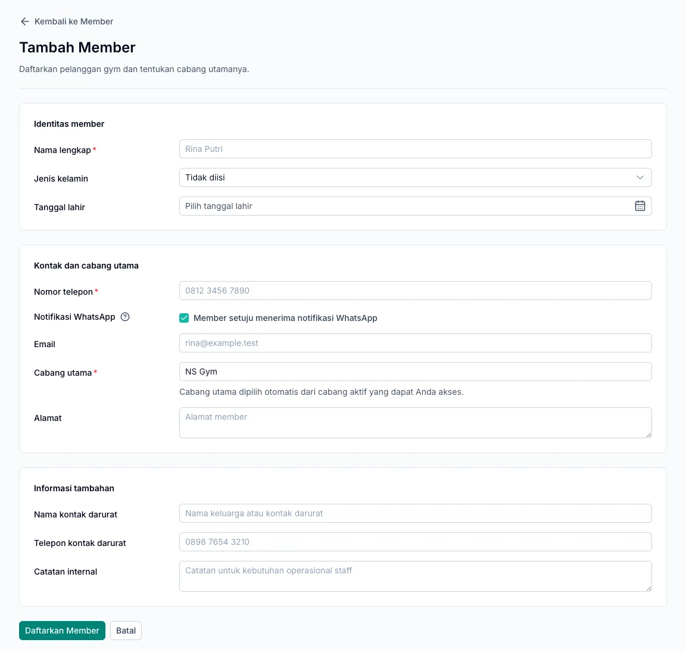

Kelola identitas, kontak, dan riwayat layanan pelanggan melalui menu **Member**. Mulai dengan profil yang benar agar pembelian dan kunjungan tercatat atas nama orang yang tepat.

<Note>
  Profil member tidak otomatis memberikan akses gym. Member tetap membutuhkan membership yang sudah dibayar dan berlaku untuk kunjungannya.
</Note>

## Tambah member

1. Buka **Member**, lalu tambahkan member baru.
2. Isi nama lengkap dan data kontak.
3. Pilih cabang utama yang sesuai.
4. Lengkapi informasi tambahan yang diperlukan, seperti kontak darurat.
5. Periksa pilihan **Member setuju menerima notifikasi WhatsApp**.
6. Simpan, lalu periksa nama, kontak, dan cabang pada detail member.

Pilihan WhatsApp pada form baru sudah aktif. Sesuaikan dengan persetujuan member dan periksa nomor tujuannya sebelum menyimpan.

*Form pendaftaran member. Nama dan kontak berwarna abu-abu merupakan petunjuk pengisian, bukan data member.*

## Perbarui profil member

Cari member pada daftar, buka profilnya, lalu pilih edit. Periksa kembali nama, nomor telepon, dan cabang sebelum menyimpan.

Ketika nomor WhatsApp diganti, periksa kembali persetujuan notifikasinya. Menonaktifkan persetujuan menghentikan pesan otomatis yang belum dikirim.

## Lihat membership dan riwayat

Dari detail member, periksa paket dan masa berlaku membership. Gunakan riwayat transaksi serta layanan untuk menelusuri pembelian yang terkait dengan member tersebut.

Membership yang belum dibayar atau belum memasuki tanggal mulai belum dapat digunakan untuk check-in. Lihat [panduan membership](/id/operations/memberships).

## Lihat dan gunakan add-on

Tab **Add-on** menampilkan pembelian yang sudah lunas dan dikaitkan dengan member. Untuk layanan yang mendukung pencatatan pemakaian, gunakan **Catat pemakaian** dan periksa **Riwayat pemakaian**.

Check-in gym tidak otomatis mengurangi saldo add-on umum. Saldo sesi kelas dan personal training dikelola melalui modul layanan masing-masing.

## Member tidak ditemukan?

Periksa ejaan nama, pencarian, dan cabang aktif. Jika profil tetap tidak terlihat, minta pemilik gym memeriksa akses cabang Anda sebelum membuat profil kedua.

Setelah profil siap, lanjutkan ke [pembelian membership](/id/operations/memberships).
