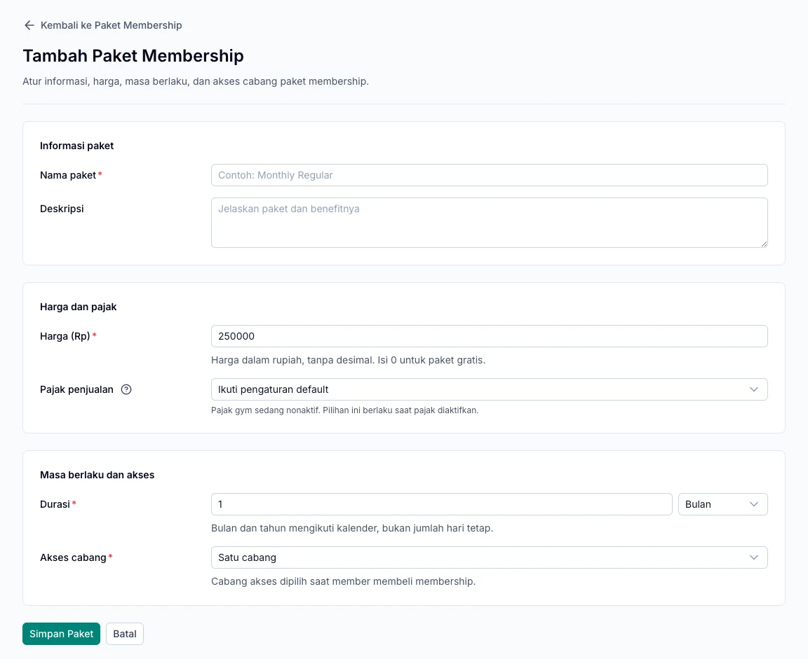

Gunakan membership untuk menentukan berapa lama member dapat mengakses gym dan cabang mana yang boleh dikunjungi. Siapkan paket melalui **Paket & Layanan → Paket Membership**, lalu catat pembeliannya atas nama member.

## Siapkan paket membership

1. Tambahkan paket membership.
2. Isi nama, harga, dan durasi.
3. Pilih satuan durasi: hari, minggu, bulan, atau tahun.
4. Tentukan akses satu cabang, cabang tertentu, atau semua cabang.
5. Periksa cabang yang berlaku, lalu simpan.

<Note>
  Durasi bulan dan tahun mengikuti kalender. Paket satu bulan tidak selalu sama dengan 30 hari. Periksa tanggal mulai dan berakhir pada ringkasan pembelian.
</Note>

Perubahan paket katalog tidak menulis ulang ketentuan pembelian member yang sudah tercatat.

*Tentukan harga, masa berlaku, dan akses cabang sebelum paket dijual. Nilai pada gambar adalah contoh tampilan form.*

## Jual membership melalui kasir

1. Buka **Kasir** pada cabang transaksi yang sesuai.
2. Pilih paket membership pada katalog.
3. Pilih member aktif, tanggal mulai, dan cabang akses jika diminta.
4. Tinjau keranjang dan ringkasan pembayaran.
5. Terima pembayaran melalui metode yang dipilih, kemudian konfirmasi.
6. Periksa hasil transaksi dan periode membership member.

Satu transaksi kasir mendukung satu paket membership. Jika perlu paket membership lain, buat transaksi terpisah.

## Buat pembelian dari detail member

Detail member juga menyediakan alur **Beli Membership**. Pilih paket, cabang, dan tanggal mulai, lalu gunakan **Tinjau Pembelian** untuk memeriksa ringkasannya sebelum melanjutkan.

Jika hasilnya berupa tagihan belum dibayar, selesaikan pembayaran melalui kasir. Membuat tagihan saja belum memberikan akses check-in.

## Perpanjang membership

Buat pembelian berikutnya untuk member yang sama. Periksa tanggal akhir membership lama dan tanggal mulai paket baru agar periode sesuai kebutuhan serta tidak bertumpang tindih.

Pembayaran untuk periode mendatang tidak selalu berarti member dapat langsung check-in hari ini. Akses mengikuti masa berlaku yang tercatat.

<AccordionGroup>
  <Accordion title="Membership sudah dibeli, tetapi belum bisa dipakai?">
  | Periksa | Kondisi yang diperlukan |
  | --- | --- |
  | Pembayaran | Sudah lunas. |
  | Masa berlaku | Tanggal mulai sudah tiba dan periode belum berakhir. |
  | Cabang kunjungan | Termasuk dalam akses membership. |
  | Status | Member dan cabang aktif. |

  Setelah seluruhnya sesuai, catat kedatangan melalui [Check-in](/id/operations/check-in).
  </Accordion>
</AccordionGroup>
