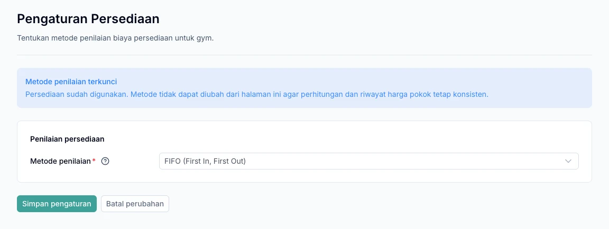

Pantau jumlah barang di setiap gudang melalui **Persediaan → Stok Barang**. Gunakan proses yang sesuai saat barang masuk, dipindahkan, atau dikoreksi agar riwayat stok tetap mudah ditelusuri.

## Siapkan gudang dan metode penilaian

Buat gudang pada cabang yang sesuai melalui **Persediaan → Gudang**. Pemilik gym kemudian menyimpan metode pada **Pengaturan → Persediaan** sebelum mutasi pertama.

Metode ini merupakan pengaturan awal untuk seluruh gym, bukan pilihan yang diulang pada setiap produk, gudang, atau pembelian.

1. Masuk menggunakan akun pemilik gym.
2. Buka **Pengaturan → Persediaan**.
3. Pilih **FIFO** atau **Average** sesuai cara gym menghitung biaya persediaan.
4. Pilih **Simpan pengaturan**, termasuk jika tetap menggunakan pilihan awal FIFO.
5. Setelah tersimpan, lanjutkan pencatatan stok awal atau penerimaan barang.

| Metode | Cara menentukan biaya barang keluar |
| --- | --- |
| FIFO | Menggunakan biaya stok yang masuk lebih dahulu. |
| Average | Menggunakan rata-rata tertimbang nilai stok. |

Sebagai contoh, gym menerima 10 barang dengan biaya Rp1.000 per barang, lalu 10 barang dengan biaya Rp2.000 per barang. Untuk barang pertama yang keluar, FIFO memakai biaya Rp1.000, sedangkan Average memakai biaya Rp1.500. Metode ini menentukan biaya persediaan, bukan harga jual produk.

<Warning>
  Metode masih dapat diubah sebelum pergerakan stok pertama. Setelah pergerakan stok pertama berhasil dicatat, metode terkunci dan tidak dapat diganti melalui pengaturan. Menyimpan draft pembelian saja belum mengunci metode. FIFO mengatur perhitungan biaya, bukan pelacakan kedaluwarsa fisik barang.
</Warning>

*Contoh kondisi setelah persediaan digunakan: metode penilaian terkunci dan tidak dapat diubah.*

## Pilih proses sesuai kebutuhan

| Keperluan | Gunakan |
| --- | --- |
| Barang datang dari supplier | Pembelian dan penerimaan barang |
| Memasukkan stok awal atau koreksi tertentu | Penyesuaian Stok |
| Memindahkan barang antargudang | Transfer Stok |
| Mencocokkan sistem dengan hitungan fisik | Stok Opname |

## Stok awal dan penyesuaian

1. Buka **Persediaan → Penyesuaian Stok**.
2. Pilih gudang, arah masuk atau keluar, produk, dan jumlah.
3. Untuk stok masuk, isi harga modal yang sesuai.
4. Tambahkan alasan atau referensi koreksi.
5. Simpan draft, periksa, lalu posting.

Posting menerapkan perubahan draft ke stok. Setelah diposting, dokumen tidak dapat diedit; buat dokumen koreksi jika ada kesalahan. Jumlah stok keluar tidak boleh melebihi stok tersedia.

## Transfer antargudang

1. Buat draft dengan gudang asal dan tujuan berbeda.
2. Tambahkan barang serta jumlah yang akan dipindahkan.
3. Pilih **Kirim barang** setelah memeriksa dokumen.
4. Petugas tujuan memilih **Terima barang** sesuai jumlah yang benar-benar tiba.

Pengiriman mengurangi stok asal. Stok tujuan baru bertambah saat penerimaan dicatat. Penerimaan boleh sebagian; sisa barang tetap tercatat dalam perjalanan. Hanya draft yang dapat dibatalkan.

## Stok opname

1. Buat draft untuk gudang dan produk yang akan dihitung.
2. Hitung barang fisik setelah acuan tersimpan.
3. Isi hasil hitung: kosong berarti belum dihitung, sedangkan **0** berarti tidak ada barang.
4. Periksa selisih dan isi harga modal satuan dasar untuk selisih lebih.
5. Konfirmasi setelah seluruh barang selesai dihitung.

### Jika stok berubah saat dihitung

Transaksi gudang tetap dapat berjalan selama opname. Jika muncul **Stok berubah**, pilih **Perbarui acuan**, lalu hitung ulang produk yang berubah. Lakukan opname saat aktivitas gudang lebih sepi agar hasil hitung tidak perlu sering diperbarui.

## Telusuri selisih stok

Pastikan gudang dan periode yang dilihat benar, lalu cocokkan riwayat penerimaan, transfer, penjualan, dan penyesuaian. Telusuri dokumen sumber sebelum membuat koreksi.

Untuk barang yang datang dari supplier, lanjutkan ke [Pembelian barang](/id/purchasing/purchase-orders).
