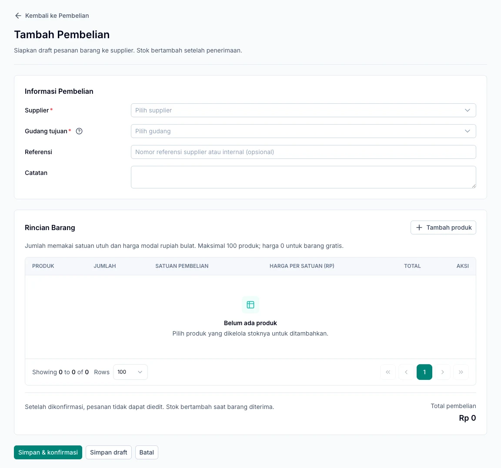

Catat barang yang dipesan ke supplier, lalu terima sesuai jumlah yang benar-benar tiba. Alurnya dimulai dari **Pembelian → Pembelian Barang**.

<Note>
  Stok bertambah saat penerimaan barang dicatat. Membuat pesanan atau membayar supplier belum menambah stok.
</Note>

## Sebelum membuat pembelian

Siapkan supplier aktif, gudang tujuan, dan produk dengan **Kelola stok**. Sebelum menerima barang pertama, pemilik gym harus menyimpan metode penilaian persediaan.

## 1. Buat pesanan

1. Buka **Pembelian → Pembelian Barang** dan tambah pembelian.
2. Pilih supplier serta gudang tujuan.
3. Tekan **Tambah produk** untuk membuka daftar produk.
4. Cari nama atau SKU, pilih satu atau beberapa produk, lalu tambahkan.
5. Isi jumlah, satuan pembelian, dan harga modal per satuan yang dipilih.
6. Periksa subtotal, referensi, serta catatan.
7. Pilih **Simpan draft** jika masih perlu diperiksa, atau **Simpan & konfirmasi** jika pesanan sudah siap.

Pilihan produk tetap tersimpan saat berpindah halaman atau mencari produk lain di modal. Produk yang sudah ada dalam rincian tidak perlu ditambahkan lagi. Satu pembelian dapat berisi hingga 100 produk berbeda.

Nomor PO dibuat otomatis, misalnya `PO-202611-0001`. Simpan nomor ini sebagai acuan saat menerima barang atau mencatat tagihan supplier.

Setelah dikonfirmasi, rincian pesanan tidak dapat diedit. Tombol konfirmasi hanya tersedia bagi akun yang memiliki izin.

*Lengkapi supplier dan gudang, lalu gunakan Tambah produk untuk mengisi rincian pesanan.*

## Kenali status pesanan

| Status | Artinya |
| --- | --- |
| Draft | Masih disiapkan dan dapat diedit; belum menambah stok. |
| Dikonfirmasi | Pesanan siap diterima; rinciannya tidak dapat diubah. |
| Diterima sebagian | Sebagian barang sudah dicatat masuk. |
| Diterima penuh | Seluruh jumlah pesanan sudah diterima. |
| Dibatalkan | Pesanan dihentikan sesuai ketentuan pembatalan. |

## 2. Terima barang yang datang

1. Buka pesanan yang sudah dikonfirmasi.
2. Pilih **Terima barang**.
3. Isi jumlah yang benar-benar tiba; isi nol untuk barang yang belum datang.
4. Periksa satuan dan jumlah sisa pesanan.
5. Konfirmasi penerimaan, lalu periksa stok gudang tujuan.

### Contoh penerimaan bertahap

Anda memesan **10 dus**, tetapi baru **6 dus** yang tiba. Catat 6 dus terlebih dahulu; status pesanan menjadi **Diterima sebagian**. Ketika 4 dus sisanya datang, buka pesanan yang sama dan catat penerimaan berikutnya.

## Batalkan pesanan

Pesanan yang belum pernah diterima dapat dibatalkan dengan alasan. Jika sudah ada tagihan aktif, selesaikan pembatalan tagihan sesuai ketentuan terlebih dahulu. Setelah ada penerimaan, pesanan tidak dapat dibatalkan melalui tindakan ini.

## 3. Catat tagihan dan pembayaran

Dari detail pembelian atau penerimaan, pilih **Buat tagihan supplier** jika tersedia. Ikuti [Tagihan supplier](/id/purchasing/supplier-invoices) untuk mencatat kewajiban dan pembayarannya.

## Pesanan tersimpan, tetapi belum dikonfirmasi?

Buka detail pesanan dan periksa statusnya. Jika masih draft, perbaiki isian yang ditandai lalu konfirmasi dokumen tersebut. Tidak perlu membuat pesanan baru untuk pembelian yang sama.
